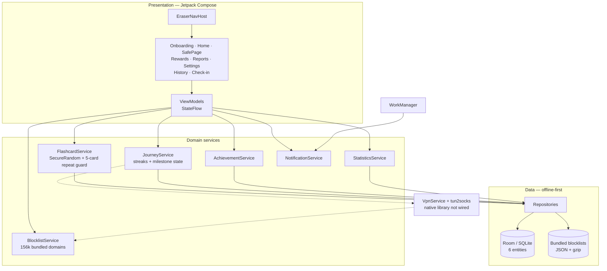

# Compose Cognitive Intervention Engine

**A native Android reference implementation of a gamified behavior-change loop: offline-first Room persistence, Hilt dependency injection, MVVM with Coroutines/Flow, deterministic intervention scheduling, and streak/achievement computation in Kotlin and Jetpack Compose.**

This repository is the native Android rewrite of an earlier Flutter recovery app. It helps a user interrupt compulsive pornography use by combining a network-level block boundary, a flashcard intervention, and a daily streak/achievement loop. The VPN interception layer is deliberately isolated and is **not wired** in this build; see [Status and boundaries](#status-and-boundaries).

The point of publishing it is the engineering: a fully offline app with a testable domain layer, explicit state machines, and no account or network dependency.

---

## Architecture



The dependency direction is one-way: Compose screens observe ViewModel state, ViewModels call domain services, and only repositories touch Room or bundled assets. `VpnManager` is the single seam where network interception would enter.

---

## The intervention loop

1. **Trigger.** A block event or a manual check-in opens the Safe Page.
2. **Intervene.** `FlashcardService` selects one of the 60 seeded cards using `SecureRandom`, excluding the last five cards shown. Every selection is recorded as an `InterventionSessionEntity`.
3. **Respond.** The user completes or skips the card. Completion and skip rates update the card's effectiveness score.
4. **Check in.** `JourneyService` records the daily log and recomputes the current streak, longest streak, and total clean days.
5. **Reward.** Crossing a milestone (`1, 3, 7, 14, 30, 60, 90, 180, 365` days) unlocks the corresponding achievement and emits an immediate UI event.

The domain logic is plain Kotlin with injected DAOs, so each step is unit-testable without an emulator.

---

## Stack

| Layer | Choice |
| --- | --- |
| Language | Kotlin 1.9 |
| UI | Jetpack Compose, Material 3 |
| Architecture | MVVM + unidirectional state flow |
| Persistence | Room 2.6.1 (6 entities, exported schemas) |
| DI | Hilt 2.48 |
| Async | Coroutines + Flow |
| Background | WorkManager 2.9.0 |
| Build | Gradle 8.12, Kotlin DSL |
| SDK | minSdk 24, targetSdk 34, compileSdk 34 |
| Tests | JUnit4 + Compose UI test + navigation test |

---

## Test coverage

Thirteen test files cover the domain and UI state layers:

- `FlashcardServiceTest`, `JourneyServiceTest`, `AchievementServiceTest`
- `StatisticsServiceTest`, `BlocklistServiceTest`, `NotificationServiceTest`
- ViewModel tests for onboarding, home, safe page, rewards, reports, history, and check-in
- `NavigationTest` (instrumentation)

```bash
./gradlew test
./gradlew connectedAndroidTest   # requires a device or emulator
```

---

## Status and boundaries

**Implemented and tested**

- All eight screens and the navigation graph
- Onboarding, daily check-in, streak and milestone logic
- SecureRandom flashcard selection with a repeat guard
- Achievement unlocking and persistence
- Room schema and DAO layer
- Bundled blocklists (156k+ domains) and whitelist loading
- WorkManager-driven notifications

**Not implemented**

- **VPN interception.** `EraserVpnService` and `Tun2SocksManager` require a native `libtun2socks-jni.so` that is not in this repository. The VPN toggle is therefore UI-only, and no traffic is actually blocked.
- Consequently, flashcard interventions do not fire from real blocked traffic; they are reachable from the Safe Page and manual flows.

This boundary is intentional and documented rather than hidden. The app is a complete UI/domain reference; it is not a shipping content blocker.

---

## Build

```bash
git clone https://github.com/itsoumya-d/compose-cognitive-intervention-engine.git
cd compose-cognitive-intervention-engine
./gradlew clean assembleDebug
adb install -r app/build/outputs/apk/debug/app-debug.apk
```

Requires JDK 17 and Android SDK 34.

---

## Repository layout

```
app/src/main/kotlin/com/eraser/recovery/
├── data/          # Room entities, DAOs, repositories
├── di/            # Hilt modules
├── domain/        # flashcard, journey, achievement, statistics,
│                  # notification, blocklist, vpn
├── receiver/      # boot / package-change receivers
├── ui/            # Compose screens, ViewModels, theme, navigation
└── vpn/           # VpnService + tun2socks boundary (not wired)
docs/progress/     # phase-by-phase engineering logs (archived)
```

The phase reports were moved out of the repository root into `docs/progress/` so the top level reads as a project, not a work log.

---

## Author

Soumya Debnath — [@itsoumya-d](https://github.com/itsoumya-d)
